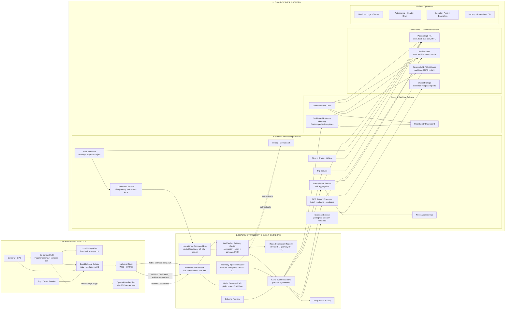

# DriverGuard — Kiến Trúc Hệ Thống Quy Mô Lớn

## 1. Mục tiêu và ranh giới

Tài liệu này chỉ mô tả **kiến trúc mục tiêu** cho hàng chục nghìn xe kết nối đồng thời. Đây không phải trạng thái đã triển khai của prototype.

Theo nguyên tắc SRP, file này chịu trách nhiệm duy nhất cho **cấu trúc tĩnh, ranh giới thành phần, luồng dữ liệu cấp cao và các quyết định triển khai hệ thống**. Use Case Model và Sequence Diagram được quản lý trong tài liệu riêng; không đặt luồng tương tác chi tiết vào đây.

Ba miền kiến trúc chính:

1. **Mobile / Vehicle Edge:** AI chạy tại xe, cảnh báo local hoạt động ngay cả khi mất mạng.
2. **Realtime Transport & Event Backbone:** giữ kết nối, tiếp nhận dữ liệu và hấp thụ tải đột biến.
3. **Cloud Server Platform:** xử lý nghiệp vụ, lưu trữ, HITL, dashboard và vận hành hệ thống.

Nguyên tắc bắt buộc:

- Không stream video liên tục.
- Không ghi GPS trực tiếp vào database trong request nhận dữ liệu.
- Không broadcast toàn bộ vị trí xe tới mọi dashboard.
- GPS có thể giảm mẫu/coalesce; cảnh báo critical và lệnh HITL không được âm thầm bỏ.
- Server hỏng hoặc mất mạng không được làm dừng cảnh báo an toàn tại thiết bị.

## 2. Bức tranh kiến trúc toàn hệ thống



## 3. Trách nhiệm và điều không được làm

| Thành phần | Trách nhiệm chính | Không được làm |
|---|---|---|
| Mobile DMS | Suy luận AI, temporal logic, cảnh báo local | Chờ server mới cảnh báo tài xế |
| Local Outbox | Lưu event chưa gửi, retry có jitter, chống gửi trùng | Giữ vô hạn hoặc retry dồn dập |
| WebSocket Gateway | Giữ socket, heartbeat, alert, command/ACK | Ghi DB, chạy risk workflow, broadcast toàn hệ thống |
| Telemetry Ingestion | Validate, rate-limit, enqueue, trả `202` | Chờ từng lệnh `INSERT` hoàn tất |
| Kafka | Buffer, replay, chia partition và cô lập consumer | Là database truy vấn cho dashboard |
| GPS Processor | Batch write, cập nhật latest state, giảm mẫu | Gửi mọi điểm tới mọi dashboard |
| Safety Service | Chuẩn hóa alert, risk aggregation, tạo case | Tự điều khiển xe |
| HITL Workflow | Đưa đề xuất cho fleet manager phê duyệt | Tự động coi đề xuất là quyết định |
| Command Service | Route lệnh, idempotency, timeout, ACK | Dựa vào socket nằm trên một server cố định |
| PostgreSQL | Dữ liệu quan hệ và workflow quan trọng | Chứa toàn bộ raw GPS lâu dài trong một bảng không partition |
| Redis | Latest state, connection registry, cache | Là nguồn lịch sử bền vững duy nhất |
| GPS Store | Lịch sử telemetry và truy vấn time-series | Chứa mật khẩu/quyền nghiệp vụ |
| Object Storage | Evidence image và file dung lượng lớn | Lưu binary trực tiếp trong bảng nghiệp vụ |

## 4. Chia cụm server và cách scale

| Cụm triển khai | Scale theo | Ghi chú |
|---|---|---|
| WebSocket Gateway | Connection count, memory, event-loop lag, outbound queue | Tách khỏi REST và worker |
| Telemetry Ingestion | Request/s, p95 latency, rate-limit count | Stateless; thêm instance ngang |
| Kafka | Partition throughput, broker disk/network, consumer lag | Partition theo `vehicleId` để giữ thứ tự một xe |
| GPS Processor | Consumer lag, rows/s, batch latency | Có thể tăng consumer tới giới hạn số partition |
| Safety Worker | Alert lag, processing latency | Ưu tiên tài nguyên hơn telemetry thường |
| Dashboard Gateway | Subscriber count, outbound bytes, slow consumers | Drop GPS delta cũ; không drop critical alert |
| PostgreSQL | Commit latency, connection pool, IOPS, replica lag | Chỉ OLTP/workflow quan trọng |
| GPS Store | Ingest rate, partition size, query latency | Retention + downsampling bắt buộc |
| Media Gateway | Active sessions, bitrate, packet loss, CPU/network | Cụm riêng, giới hạn concurrency |

## 5. Backpressure và chế độ suy giảm

| Sự cố | Hành vi đúng |
|---|---|
| Mất mạng trên xe | Cảnh báo local vẫn chạy; event vào outbox và gửi lại có jitter |
| WebSocket Gateway chết | App reconnect qua load balancer; registry chuyển sang gateway mới |
| Kafka chậm | Ingestion áp dụng bounded queue/rate limit; mobile giữ phần chưa được ACK |
| GPS Store chậm | Consumer lag tăng; ingress không chờ DB; không ảnh hưởng alert local |
| PostgreSQL chậm | Safety event vẫn nằm trong Kafka; circuit breaker bảo vệ pool |
| Dashboard client chậm | Coalesce GPS theo xe; đóng client vượt quá outbound buffer |
| Reconnect storm | Exponential backoff + jitter + admission control |
| Event gửi trùng | Deduplicate bằng `eventId`; command có `commandId` và trạng thái ACK |

## 6. Quyết định giao thức

### Giai đoạn tương thích với prototype

- WebSocket: connection, alert realtime, command và ACK.
- HTTPS REST: GPS batch, auth, nghiệp vụ và evidence metadata.
- WebRTC: video theo yêu cầu; không dùng UDP JPEG trực tiếp trên Internet ở quy mô lớn.

### Hướng tối ưu thiết bị fleet về sau

Có thể thay WebSocket + REST telemetry bằng MQTT cluster:

- QoS 0 cho GPS thường kỳ.
- QoS 1 cho safety alert và command.
- Persistent session cho thiết bị hay mất mạng.
- Last Will cho trạng thái online/offline.

Không chạy đồng thời hai đường telemetry đầy đủ trong thời gian dài. Nếu migrate, phải có version giao thức và lộ trình tắt đường cũ.

## 7. Ranh giới MVP và production

### MVP/demo

- Một gateway, một ingestion service và một broker nhỏ.
- PostgreSQL + Redis; GPS history có thể dùng PostgreSQL partitioned trong tải demo.
- Không tuyên bố chịu tải lớn khi chưa load test.

### Production lớn

- Nhiều instance mỗi cụm, multi-zone, health check và graceful drain.
- Kafka replication, schema compatibility và DLQ.
- Redis/PostgreSQL HA; GPS store chuyên time-series/analytics.
- SLO, alerting, audit, retention, backup/restore và disaster recovery.
- Load test riêng cho idle WebSocket, reconnect storm, GPS ingestion, dashboard fan-out và DB recovery.

## 8. Capacity model tối thiểu

Không chọn số server bằng cảm giác. Cần tính và benchmark ít nhất:

```text
GPS events/s        = số xe đang chạy / chu kỳ gửi GPS (giây)
GPS events/day      = số xe đang chạy × 86.400 / chu kỳ gửi
WS memory           = số connection × memory đo được mỗi connection
Dashboard fan-out   = số update sau coalesce × số subscriber thực sự liên quan
Storage/day         = event/day × kích thước row thực tế gồm index/compression
```

Mỗi cụm phải có headroom, kiểm thử mất một node và autoscaling dựa trên metric của chính workload đó.
