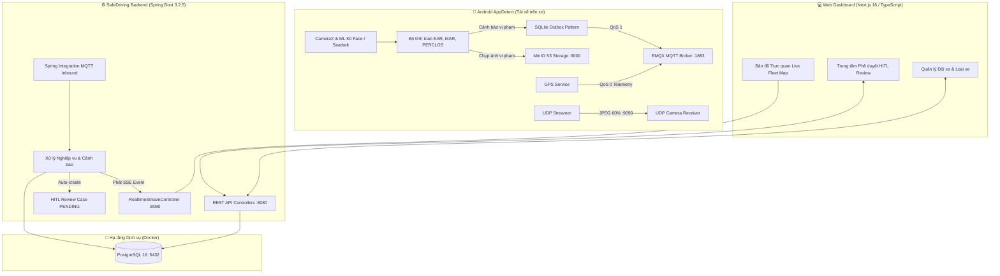

# BÁO CÁO TỔNG KẾT TIẾN ĐỘ & DANH MỤC CHỨC NĂNG HỆ THỐNG SAFEDRIVING

> **Dự án:** Hệ thống Giám sát & Quản lý An toàn Đội xe (SafeDriving / AppDetect)  
> **Thời gian cập nhật:** 11/10/2026  
> **Các thành phần hệ thống:** 
> 1. **Backend Server:** Java 21 + Spring Boot 3.2.5 (Maven, PostgreSQL 16, EMQX, MinIO)
> 2. **Web Dashboard:** Next.js 16 + React 19 + TypeScript + Leaflet + Tailwind CSS
> 3. **Mobile App:** Android Native Java (CameraX, LiteRT/TFLite, ML Kit, MQTT, MinIO)

---

## 1. SƠ ĐỒ KIẾN TRÚC TỔNG THỂ HỆ THỐNG



---

## 2. CHI TIẾT CÁC HẠNG MỤC NHÓM ĐÃ HOÀN THÀNH

### 🟢 PHẦN 1: BACKEND SERVER (`backend-safedriving`)

| Nhóm nghiệp vụ | Chức năng cụ thể | Trạng thái | Ghi chú kỹ thuật |
| :--- | :--- | :---: | :--- |
| **Xác thực & Bảo mật** | • Đăng nhập (`POST /auth/login`)<br>• Đăng ký tài khoản (`POST /auth/register`)<br>• Cấp phát và xác thực JWT token | ✅ **Xong 100%** | Phân quyền: `ADMIN`, `MANAGER`, `DRIVER`. Stateless Security. |
| **Hạ tầng IoT & Realtime** | • EMQX MQTT Inbound Adapter (`driverguard/#`)<br>• Server-Sent Events (SSE) `/api/v1/realtime/stream`<br>• MinIO S3 Presigned URL (`/api/v1/media/presigned`) | ✅ **Xong 100%** | Tự động ingest tọa độ GPS và alert từ mobile. Cấp upload URL trực tiếp lên MinIO. |
| **Quy trình HITL** | • Tự động tạo Review Case vi phạm mức HIGH/CRITICAL<br>• Lấy danh sách case chờ duyệt (`GET /api/v1/hitl/cases`)<br>• Duyệt / Bác bỏ vi phạm (`POST /api/v1/hitl/cases/{id}/review`) | ✅ **Xong 100%** | Giúp điều phối viên kiểm tra lại ảnh chụp AI trước khi phạt tài xế. |
| **Quản lý Đội xe (Vehicle)** | • Xem danh sách xe, lọc theo trạng thái (`GET /vehicles`)<br>• Xem chi tiết xe (`GET /vehicles/{id}`)<br>• Thêm mới xe (`POST /vehicles`)<br>• Cập nhật thông tin xe (`PUT /vehicles/{id}`)<br>• Xóa mềm xe (`DELETE /vehicles/{id}`)<br>• Phân công xe cho tài xế (`POST /vehicles/{id}/assign-driver`) | ✅ **Xong 100%** | Hỗ trợ 2 prefix `/vehicles` và `/api/v1/vehicles`. Tương thích cả camelCase và snake_case. |
| **Danh mục Loại xe (VehicleType)** | • Danh sách loại xe (`GET /vehicle-types`)<br>• Thêm mới loại xe (`POST /vehicle-types`)<br>• Cập nhật loại xe (`PUT /vehicle-types/{id}`)<br>• Xóa loại xe (`DELETE /vehicle-types/{id}`) | ✅ **Xong 100%** | Đã tạo đầy đủ Controller, Service, Repository, DTO. |
| **Quản trị Nhân sự & Giấy phép** | • Quản lý nhân viên (`/staff`)<br>• Quản lý tài xế (`/drivers`)<br>• Quản lý bằng lái & hạng bằng (`/licenses`, `/license-classes`) | ✅ **Xong 100%** | Hợp nhất từ nhánh `datdang`. |
| **Quản lý Thiết bị & Lộ trình** | • Quản lý thiết bị (`/devices`)<br>• Địa chỉ, Tuyến đường, Trạm dừng (`/addresses`, `/stops`, `/routes`)<br>• Ca làm việc (`/shifts`) | ✅ **Xong 100%** | Hợp nhất từ nhánh `datdo`. |
| **Kiểm thử tự động** | • Toàn bộ Unit Tests hệ thống | ✅ **189/189 Tests Passed** | 0 Failures, 0 Errors. |

---

### 🟢 PHẦN 2: WEB DASHBOARD (`frontend-safedriving`)

| Màn hình / Module | Tính năng chi tiết | Trạng thái |
| :--- | :--- | :---: |
| **Hệ thống Auth** | Giao diện Đăng nhập / Đăng ký hiện đại, lưu token vào Context, bảo vệ router. | ✅ **Hoàn thành** |
| **Live Fleet Map (`/fleet`)** | Bản đồ tương tác Leaflet thời gian thực: hiển thị marker phương tiện, màu sắc theo trạng thái (`IN_SERVICE`, `AVAILABLE`, `MAINTENANCE`), kết nối SSE cập nhật tọa độ liên tục. | ✅ **Hoàn thành** |
| **HITL Review Center (`/hitl`)** | Giao diện duyệt ảnh sự cố: hiển thị ảnh chụp vi phạm từ MinIO, các chỉ số AI (EAR, MAR, Pitch, Yaw), nút bấm Xác nhận (Confirm) / Bác bỏ (Reject) kèm lý do. | ✅ **Hoàn thành** |
| **Quản lý Đội xe (`/vehicles`)** | Bảng danh sách phương tiện, thống kê số lượng theo từng trạng thái, tìm kiếm theo biển số/VIN/loại xe, Modal thêm mới/chỉnh sửa xe, Xóa xe. | ✅ **Hoàn thành** |
| **Quản lý Loại xe (`/vehicle-types`)** | Bảng danh mục các loại xe (5 chỗ, 16 chỗ, 45 chỗ...), thống kê sức chứa, Modal thêm/sửa/xóa loại xe. | ✅ **Hoàn thành** |
| **Thanh điều hướng (Sidebar)** | Sidebar phong cách hiện đại, chuyển trang mượt mà giữa các phân hệ. | ✅ **Hoàn thành** |

---

### 🟢 PHẦN 3: MOBILE CLIENT (`AppDetect`)

| Module Mobile | Chức năng chi tiết | Trạng thái |
| :--- | :--- | :---: |
| **AI Nhận diện Buồn ngủ** | Sử dụng CameraX + ML Kit Face Mesh, tính toán độ mở mắt (EAR), độ mở miệng (MAR), tư thế đầu (Pitch/Yaw), tính PERCLOS trong cửa sổ trượt. | ✅ **Hoàn thành** |
| **AI Dây an toàn** | Model phân loại kiểm tra tài xế có thắt dây an toàn hay không (`SeatBeltDetector`). | ✅ **Hoàn thành** |
| **Bằng chứng Vi phạm (MinIO)** | Tự động trích xuất frame ảnh khi có nguy cơ cao, gọi API lấy Presigned URL và upload trực tiếp lên bucket MinIO. | ✅ **Hoàn thành** |
| **Offline Outbox (Zero Data Loss)** | Tích hợp SQLite Outbox: khi xe mất sóng (hầm/núi), toàn bộ alert được lưu vào bộ nhớ cục bộ, tự động đẩy bù lên MQTT ngay khi có mạng. | ✅ **Hoàn thành** |
| **UDP Video Streaming** | Nén frame JPEG 60%, throttle 5 FPS (200ms/frame), truyền UDP trực tiếp về cổng 9090 của máy chủ để xem live camera. | ✅ **Hoàn thành** |
| **Cấu hình Động (ENV/BuildConfig)** | Đưa IP máy chủ ra `local.properties` và `BuildConfig.SERVER_IP`, loại bỏ hoàn toàn hardcode IP trong code Java, chống dính IP vào Git. | ✅ **Hoàn thành** |

---

## 3. TỔNG KẾT TÌNH TRẠNG NHÁNH GIT (GIT BRANCHES)

* **Backend (`backend-safedriving`)**:
  - Đang chạy trên nhánh: **`feat/realtime-fleet-hitl`** (nhánh mới nhất và đầy đủ nhất).
  - Đã tích hợp trọn vẹn: Toàn bộ code của `main` (PR #1 từ `datdang` và `datdo`) + module MQTT/HITL/MinIO + toàn bộ CRUD `Vehicle` và `VehicleType` của Thủy (chuẩn hóa package `com.safedriving.*`).
* **Frontend (`frontend-safedriving`)**:
  - Đang chạy trên nhánh: **`thuy`** (kế thừa từ `feat/realtime-fleet-hitl`, bổ sung đầy đủ trang quản lý `/vehicles` và `/vehicle-types`).
* **Hạ tầng IDE**:
  - File [.vscode/tasks.json](file:///c:/Users/Admin/Desktop/Do_An/.vscode/tasks.json) đã được cấu hình chạy song song đồng thời Backend và Frontend qua phím tắt **`Ctrl + Shift + B`**.

---

## 4. HƯỚNG DẪN CHẠY NHANH HỆ THỐNG

1. **Khởi động Docker (Database + Broker + Storage)**:
   ```powershell
   cd c:\Users\Admin\Desktop\Do_An\backend-safedriving
   docker compose up -d
   ```
2. **Khởi động đồng thời Backend & Frontend**:
   - Trong VS Code: Nhấn **`Ctrl + Shift + B`** (chọn `3. Run Both (BE + FE)`).
   - Backend sẽ chạy tại: `http://localhost:8080` (Swagger UI: `/swagger-ui.html`).
   - Frontend sẽ chạy tại: `http://localhost:3000`.
3. **Chạy App Mobile**:
   - Kiểm tra IP Wi-Fi máy tính bằng lệnh `ipconfig`.
   - Điền IP vào file `local.properties` của `AppDetect` (`server.ip=...`).
   - Mở Android Studio và bấm **Run App**.
