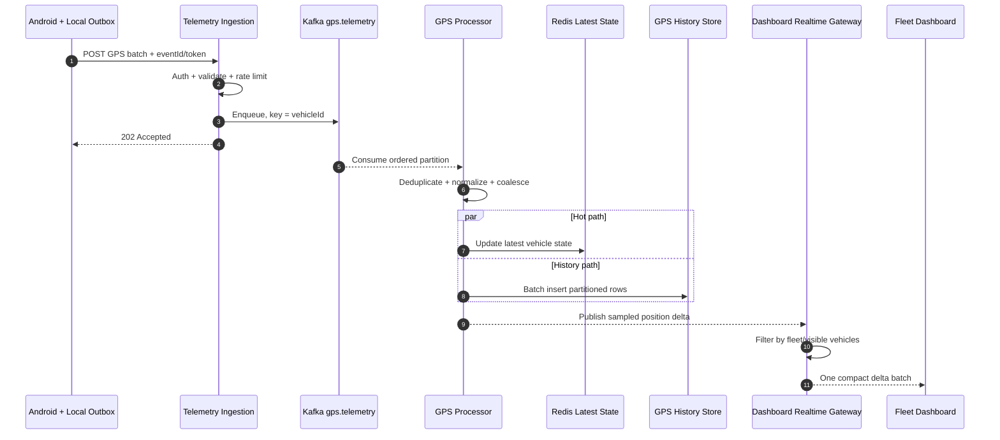

# SEQ-001 — GPS Telemetry Ingestion

## Trách nhiệm

Mô tả duy nhất luồng nhận GPS từ Android, đưa qua event backbone, cập nhật trạng thái mới nhất, lưu lịch sử và gửi delta có chọn lọc tới dashboard.

| Thuộc tính | Nội dung |
|---|---|
| Trigger | Mobile tạo GPS telemetry trong một trip đang hoạt động |
| Precondition | Device đã xác thực; local outbox hoạt động |
| Success outcome | GPS được ACK ở ingestion, xử lý bất đồng bộ và xuất hiện ở đúng fleet dashboard |
| Failure outcome | Event còn trong local outbox hoặc Kafka để retry; cảnh báo DMS local không bị ảnh hưởng |
| Architecture reference | [Large-scale System Architecture](../LARGE_SCALE_SYSTEM_DESIGN.md) |

## Sequence

## Ràng buộc riêng của sequence

- 10.000 xe gửi mỗi 5 giây tương đương khoảng 2.000 GPS event/giây và 172,8 triệu event/ngày nếu chạy liên tục.
- App gửi batch khi phục hồi mạng; không tạo hàng nghìn REST request nối tiếp.
- Xe đứng yên có thể giảm tần suất gửi.
- Dashboard đọc vị trí hiện tại từ Redis; lịch sử mới đọc GPS Store.
- GPS delta cũ có thể coalesce theo xe, nhưng không áp dụng quy tắc này cho critical safety alert.
