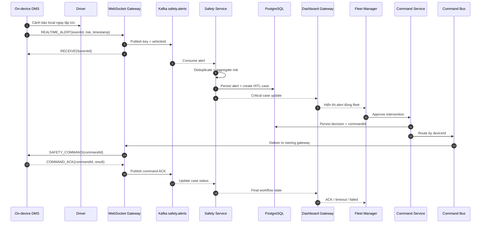

# SEQ-002 — Critical Safety Alert & HITL

## Trách nhiệm

Mô tả duy nhất luồng từ lúc DMS phát hiện nguy hiểm, cảnh báo tài xế tại chỗ, tạo safety case trên cloud, fleet manager phê duyệt và thiết bị ACK lệnh can thiệp.

| Thuộc tính | Nội dung |
|---|---|
| Trigger | On-device DMS phát sinh critical safety event |
| Precondition | DMS session đang chạy; cảnh báo local khả dụng không phụ thuộc mạng |
| Success outcome | Tài xế được cảnh báo ngay; manager thấy đúng case; lệnh đã duyệt được route và có ACK |
| Failure outcome | Local alert vẫn hoạt động; cloud case thể hiện timeout/failed thay vì báo thành công giả |
| Architecture reference | [Large-scale System Architecture](../LARGE_SCALE_SYSTEM_DESIGN.md) |

## Sequence

## Ràng buộc riêng của sequence

- Alert local luôn xảy ra trước và không chờ cloud.
- HITL chỉ quyết định hành động ở tầng fleet như liên hệ tài xế, tạm dừng cấp chuyến mới hoặc yêu cầu dừng an toàn.
- Hệ thống không điều khiển trực tiếp phương tiện.
- `eventId` và `commandId` phải idempotent.
- Không được hiển thị trạng thái “đã can thiệp” khi chưa nhận ACK hợp lệ.
