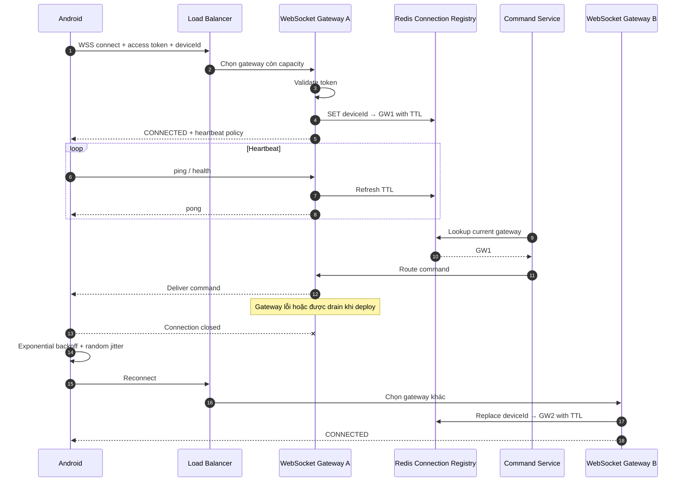

# SEQ-003 — WebSocket Connection Recovery

## Trách nhiệm

Mô tả duy nhất lifecycle kết nối WebSocket của Android: xác thực, đăng ký gateway sở hữu socket, heartbeat, route command và reconnect sang gateway khác khi lỗi hoặc deploy.

| Thuộc tính | Nội dung |
|---|---|
| Trigger | Android bắt đầu connected fleet session hoặc phát hiện socket đã đóng |
| Precondition | Device có access token và `deviceId` hợp lệ |
| Success outcome | Registry trỏ tới gateway đang giữ socket; command tới đúng thiết bị |
| Failure outcome | App retry bằng exponential backoff + jitter; mapping cũ tự hết TTL |
| Architecture reference | [Large-scale System Architecture](../LARGE_SCALE_SYSTEM_DESIGN.md) |

## Sequence

## Ràng buộc riêng của sequence

- Mỗi gateway chỉ giữ socket mà chính nó sở hữu.
- Redis Connection Registry không thay thế socket local; nó chỉ phục vụ discovery/routing.
- Mapping có TTL và được refresh bằng heartbeat.
- Client không reconnect theo chu kỳ cố định vì có thể tạo reconnect storm.
- Gateway phải graceful drain khi deploy: ngừng nhận kết nối mới trước khi đóng kết nối cũ.
